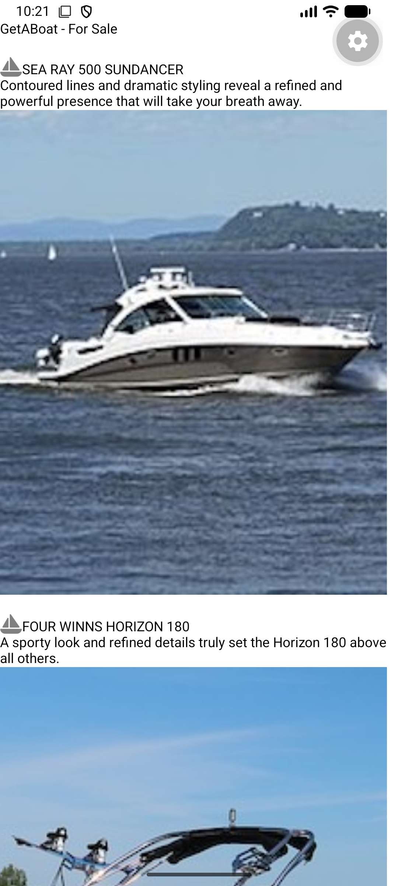

# App Name

GetABoat is an application that displays six boats available for sale. Each boat includes a name, description, and image.

The purpose of this exercise is to improve the application's appearance using React Native StyleSheet.

Different style names, such as container, header, description, and picture, are used to organize the styling of individual elements. 

This makes the code easier to reference, understand, and maintain.

# ScreenShots of App BEFORE applying Stylesheet changes
Screenshots:  

# ScreenShots of App AFTER applying Stylesheet changes
Screenshots:  

# Link to Demo Video with audible narration explaining styling changes with code reference
Demo Video Link:  
https://drive.google.com/file/d/17tOYc2PVqIUrozreMPcmV5FBh1F3mM02/view?usp=sharing

